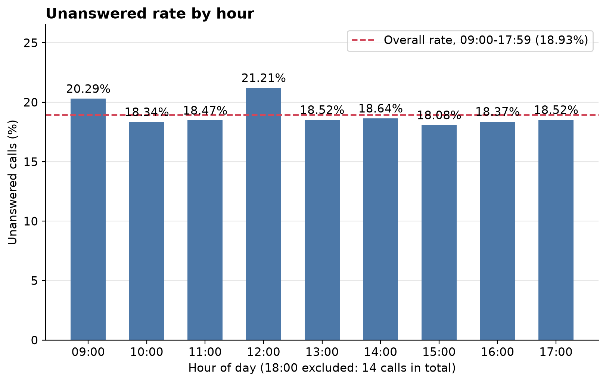
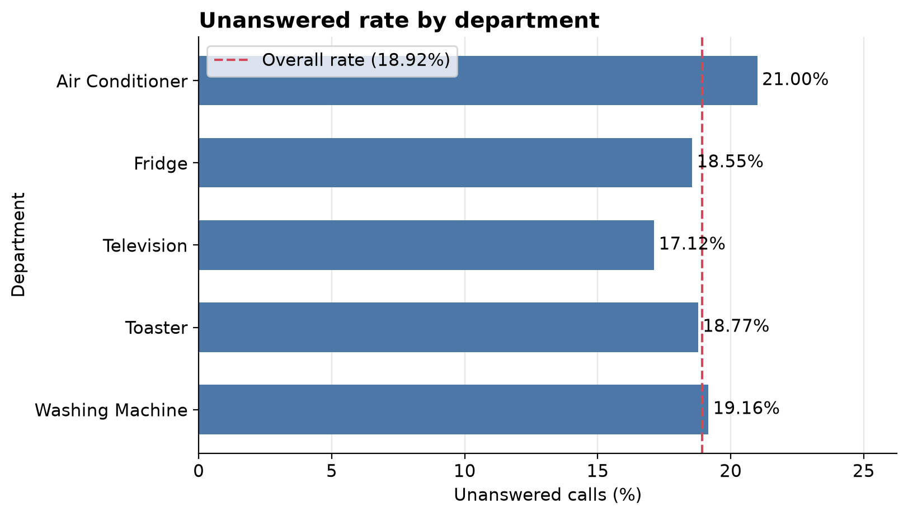

# Call Center Staffing Analytics

A descriptive analysis of why calls go unanswered in a call center dataset (5,000 calls, January to March 2015). The project cleans the raw data with Python, derives 12 KPIs with SQL (SQLite), and presents the findings in the README.

## Problem Statement

**Situation**: A call center handled 5,000 calls over three months across 8 agents and 5 product departments. The only record of its performance is a raw call log.

**Complication**: About 19% of calls (946 of 5,000) were never answered. The log does not show whether this is tied to the time of day, to particular agents, or to particular products, so there is no clear place to start fixing it.

**Question**: Is the unanswered rate concentrated in particular hours, months, agents or departments, or is it spread evenly?

**Answer**: It is spread evenly. In every cut the rate stays between 17.1% and 21.2%, so no single hour, month, agent or department explains it. That points to something affecting all calls, but the dataset has no staffing or schedule information, so it cannot show what.

## Dataset

- **Source**: "Call Center Dataset" by maryamabdelgwad on [Kaggle](https://www.kaggle.com/datasets/maryamabdelgwad/call-center-dataset). See the dataset page for its license.
- **Size and period**: 5,000 call records from 2015-01-01 to 2015-03-31 (appliance support).
- **Columns**: `call_id`, `date`, `time`, `agent`, `department`, `answered` (yes/no), `resolved`, `speed_of_answer` (seconds), `avg_talk_duration` (seconds), `satisfaction_rating` (1 to 5).
- **Provenance**: It is not clear from the dataset page whether the records are real or generated, so the results describe this dataset only and should not be read as describing any real call center.

**How the data is read**

- `answered = 'no'` means the call was never answered. The data does not say whether the caller hung up or the call went unattended.
- The 946 unanswered calls have no speed of answer, talk duration or satisfaction rating. These are stored as `NULL` and never filled with zeros.
- Agent is the agent the call was assigned to.
- Departments are product categories (Air Conditioner, Fridge, Television, Toaster, Washing Machine), not organisational units.
- Average handling time (AHT) is average talk duration only. The data has no hold or after-call work.

**Decisions made during the checks**

- The 18:00 hour is excluded from the hourly KPIs only. It has 14 calls in total, which looks like post-shift spillover and not a fully staffed hour.
- The last two days of March (30 and 31) have unusually few calls but are kept. Removing them changes March's unanswered rate by only 0.38 percentage points (19.29% vs 18.91%).
- Agents and departments are compared directly, with no adjustment between groups.

## Approach

1. **Clean** (`notebooks/01_cleaning.ipynb`): clean the raw file, export a processed CSV and build a SQLite database.
2. **Check** (`notebooks/02_exploratory_checks.ipynb`, `sql/01_initial_checks.sql`, `sql/02_sensitivity_checks.sql`): explore the data and test the decisions above.
3. **View** (`sql/00_create_view.sql`): `vw_call_records_enriched` adds month, day of week and hour of day to every call.
4. **KPIs** (`sql/kpis/`): one SQL file per KPI, 12 in total.
5. **Analyse** (`notebooks/03_kpi_analysis.ipynb`): run the queries, reconcile them against each other, chart each KPI against its overall figure, and write the observations and findings.

| Metric | Cut by |
|---|---|
| Unanswered call rate | hour, month, agent, department |
| Average handling time (AHT) | agent, department |
| Average satisfaction rating | agent, department |
| Average speed of answer | hour, month, agent, department |

Before charting, the notebook checks that the queries agree with each other (row counts, call totals, answered and unanswered counts, speed-of-answer totals and weighted averages). It stops with an error if any of them do not.

## Key Findings

| # | Observation | So what |
|---|---|---|
| 1 | About 19% of calls go unanswered (946 of 5,000). Every cut stays within 17.1% to 21.2%: month 17.89 to 19.68, hour 18.08 to 21.21, agent 17.38 to 20.85, department 17.12 to 21.00. | No single hour, month, agent or product accounts for the unanswered calls. This points to something affecting all calls, but the data cannot say what. |
| 2 | The hour, agent and department cuts each have one group about 2 points above the overall rate: 12:00 (21.21%), Air Conditioner (21.00%) and Diane (20.85%). The month cut is flatter (February +0.76). | Small gaps. Worth revisiting if more data becomes available. |
| 3 | AHT is 224.4 s overall. Every agent is within 7 s of it. Toaster has the shortest AHT at 215.4 s, 9.0 s (about 4%) below overall. | Handling time is similar across agents and products. This is talk time only. |
| 4 | Average satisfaction is 3.40 out of 5, and every agent and department is within 0.07. | Customers rate the service about the same whoever answers and whatever the product. Ratings exist only for answered calls. |
| 5 | Average speed of answer is 67.5 s overall. 10:00 is the slowest hour (71.1 s) and 09:00 the fastest (64.8 s). Joe's calls are the slowest (71.0 s) and Becky's the fastest (65.3 s). | Answered calls wait just over a minute on average. Whether that is acceptable depends on a service target, which this data does not include. |





**Limitations**

- The data covers one quarter (5,000 calls) and has no staffing or schedule information, so it cannot show whether demand outstrips staffing at certain times.
- The analysis is descriptive. Small gaps between groups may be normal variation and are not treated as findings.

## Tech Stack

- **Python**: pandas, matplotlib, sqlparse
- **SQL**: SQLite (queries run through Python's `sqlite3`)
- **Notebooks**: JupyterLab
- **Environment**: uv

## Repository Structure

```
call-center-staffing-analytics/
├── data/
│   ├── raw/            # original dataset (see How to run it)
│   ├── processed/      # cleaned CSV
│   └── database/       # SQLite database (generated, not committed)
├── notebooks/
│   ├── 01_cleaning.ipynb
│   ├── 02_exploratory_checks.ipynb
│   └── 03_kpi_analysis.ipynb
├── sql/
│   ├── 00_create_view.sql
│   ├── 01_initial_checks.sql
│   ├── 02_sensitivity_checks.sql
│   └── kpis/           # one file per KPI (12)
├── reports/
│   └── charts/
├── pyproject.toml
└── README.md
```

## Future Plans

- Repeat the analysis on data that includes staffing or schedule information, so the coverage question can be tested directly.
- Look at arrivals in shorter intervals (for example, half-hours) to find peaks within an hour.
- Add a service-level measure (share of calls answered within a target time) once a target is defined.

## How to run it

**Requirements**: Python (version in `pyproject.toml`) and [uv](https://docs.astral.sh/uv/).

1. Clone the repository and install the dependencies:

   ```bash
   git clone https://github.com/Ashish-Krishna-K/call-center-staffing-analytics.git
   cd call-center-staffing-analytics
   uv sync
   ```

2. Download the dataset from [Kaggle](https://www.kaggle.com/datasets/maryamabdelgwad/call-center-dataset) and place the CSV in `data/raw/`.

3. Start JupyterLab:

   ```bash
   uv run jupyter lab
   ```

4. Run the notebooks in order with **Restart & Run All**:
   1. `notebooks/01_cleaning.ipynb` creates `data/processed/processed_data.csv` and `data/database/call_center.db`.
   2. `notebooks/02_exploratory_checks.ipynb` runs the checks.
   3. `notebooks/03_kpi_analysis.ipynb` recreates the view, runs the 12 KPI queries, reconciles them and saves the charts to `reports/charts/`.

The KPI queries can also be run on their own in any SQLite client (version 3.30 or later) after running `sql/00_create_view.sql` on the database.